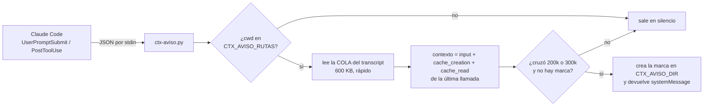

# ctx-aviso

**EN:** A tiny [Claude Code](https://claude.com/claude-code) hook that warns you — once — when a session's context
passes 200k and 300k tokens, so you compact or start a fresh session before long contexts eat your usage quota.
It only warns; it never blocks. Python standard library only, with a test suite.

---

Hook de Claude Code que avisa **una sola vez** cuando el contexto de la sesión pasa de **200k** y de **300k** tokens.

## Por qué existe

En sesiones largas cada llamada al modelo vuelve a leer todo el contexto acumulado. Medí el uso de mis propias
sesiones: la gran mayoría del gasto estaba en llamadas con más de 120k de contexto, y un tope de unos 200k
ahorraba hasta un tercio de la cuota (cota superior). Pero uno no se da cuenta de cuándo cruza ese umbral. Este
hook lo avisa en el momento.

## Cómo funciona



- Lee solo el final del transcript, no el archivo entero, y no imprime contenido de la conversación.
- Deja una marca por sesión y nivel, así que no repite el aviso.
- Se **rearma** si, tras compactar, el contexto baja de 150k.
- **Falla en abierto:** cualquier error sale con código 0 y en silencio. Un hook de aviso nunca debe romper tu sesión.

## Instalación

1. Copia `ctx-aviso.py` a donde quieras (por ejemplo `~/.claude/hooks/`).
2. Regístralo en `~/.claude/settings.json` para los dos eventos:

```json
{
  "hooks": {
    "UserPromptSubmit": [{ "hooks": [{ "type": "command", "command": "python3 ~/.claude/hooks/ctx-aviso.py" }] }],
    "PostToolUse":      [{ "hooks": [{ "type": "command", "command": "python3 ~/.claude/hooks/ctx-aviso.py" }] }]
  }
}
```

`PostToolUse` hace que también avise en turnos largos donde tú no escribes ningún prompt.

## Configuración

| Variable | Por defecto | Qué hace |
|---|---|---|
| `CTX_AVISO_RUTAS` | `/proyecto-a/,/proyecto-b/` | Fragmentos de ruta, separados por coma. Solo avisa si el directorio de trabajo contiene alguno. |
| `CTX_AVISO_DIR` | `/tmp/ctx-aviso` | Dónde guarda las marcas de «ya avisé». |

Los niveles (200k, 300k) y el umbral de rearme (150k) son constantes al inicio del archivo.

## Pruebas

```bash
python3 test-ctx-aviso.py
```

Cubre ambos niveles, el no repetir, el rearme tras compactar, ambos eventos, rutas fuera de alcance, un
transcript inexistente y una entrada que no es JSON.

## Estado

Mide los tokens de la **última llamada del asistente**, no la ventana real del modelo, así que es una
aproximación útil, no un contador exacto.

## Licencia

MIT — ver [LICENSE](LICENSE).
